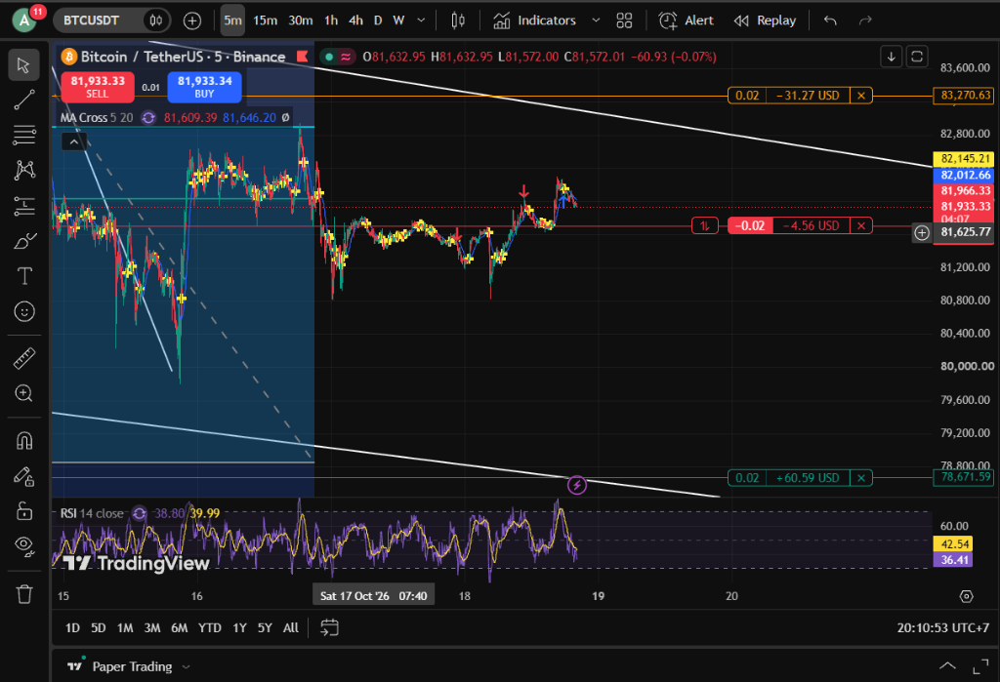
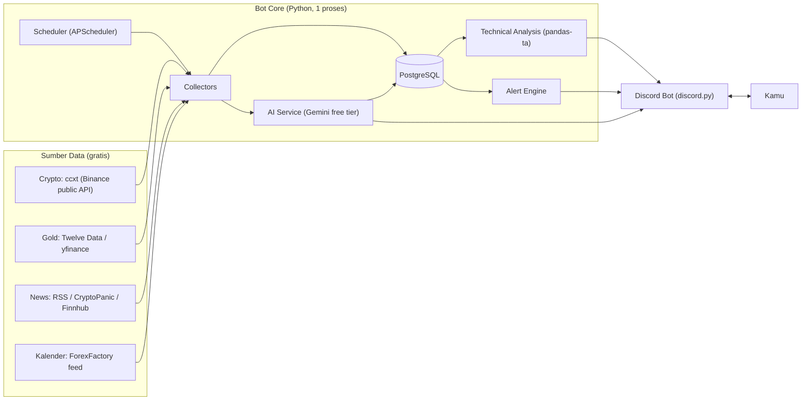
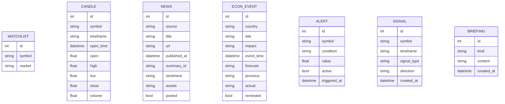
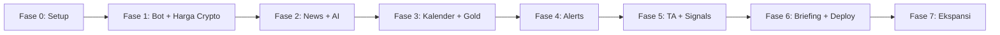

# 📈 Blueprint: Trading & Economic News Bot (Discord)

> Nama bot: **BotBawel** 🗣️
> Versi plan: **v3** — nama bot, indikator, dan setup database sudah final.

---

## 0. Ringkasan Keputusan

| Topik | Keputusan |
|---|---|
| Nama bot | **BotBawel** |
| Platform | Discord |
| Pengguna | Personal (1 server pribadi) |
| Bahasa kode | Python |
| Bahasa output bot | **Bahasa Indonesia** |
| Watchlist awal | **BTC, ETH, XAU/USD** (testing paling banyak di crypto) |
| Timeframe | **15m, 30m (default), 1h** |
| Indikator | **EMA Cross 5/20**, **RSI 14 + MA-nya**, trendline/channel & level support-resistance |
| Daily Briefing | **07:00 WIB & 19:00 WIB** + bisa diminta manual kapan saja (`/briefing`) |
| Database | **PostgreSQL** (sudah terinstall di laptop, dikelola via DBeaver) — tanpa Docker |
| Biaya | **Semua gratis** (free tier / open source) |
| Hosting | Development di laptop → production di **Oracle Cloud Always Free** |
| Trading | Info + sinyal saja, **tanpa eksekusi order** (auto-trading = future) |

---

## 1. Konsep

Sebuah **bot Discord personal** yang jadi "asisten market" kamu:

- Ngumpulin **berita ekonomi & market** dari berbagai sumber, lalu **diringkas + dianalisis sentimennya oleh AI (LLM)** dalam Bahasa Indonesia.
- Ngasih tahu **jadwal rilis data ekonomi penting** (CPI, NFP, FOMC, dll — lihat [Glosarium](#2-glosarium-istilah-ekonomi)) + reminder sebelum rilis.
- Pantau **harga** aset di watchlist dan kirim **alert** kalau menyentuh level tertentu.
- Kasih **analisis teknikal & sinyal** di timeframe 15m / 30m / 1h sebagai *bahan pertimbangan*, **bukan** eksekusi order.
- Kirim **Briefing 2x sehari** (07:00 & 19:00 WIB), plus bisa diminta manual kapan saja.

> [!IMPORTANT]
> Bot ini **tidak mengeksekusi order** (read-only). Eksekusi otomatis masuk fase *future*, setelah semua fondasi stabil.

---

## 2. Glosarium Istilah Ekonomi

Ini data/event yang paling sering **bikin market (terutama Gold & USD) bergerak liar**. Bot akan kasih reminder untuk event-event ini.

| Istilah | Kepanjangan | Apa itu? | Kenapa penting buat XAU/USD & Crypto? |
|---|---|---|---|
| **CPI** | Consumer Price Index | Ukuran **inflasi** di AS: seberapa cepat harga barang/jasa naik. Rilis bulanan. | Inflasi tinggi → The Fed cenderung **naikkan/tahan suku bunga tinggi** → USD menguat → Gold & crypto biasanya **turun**. Inflasi rendah → kebalikannya. |
| **Core CPI** | CPI tanpa makanan & energi | Versi CPI yang lebih "stabil", sering lebih diperhatikan The Fed. | Sama seperti CPI, tapi sering dampaknya lebih besar. |
| **PPI** | Producer Price Index | Inflasi di level **produsen** (harga grosir). | Sinyal awal CPI ke depan. |
| **PCE** | Personal Consumption Expenditures | Ukuran inflasi **favorit The Fed**. | Mempengaruhi ekspektasi suku bunga. |
| **NFP** | Non-Farm Payrolls | Jumlah **lapangan kerja baru** di AS (di luar sektor pertanian). Rilis **Jumat pertama tiap bulan**. | Salah satu event paling volatile. NFP kuat → ekonomi kuat → USD naik → Gold cenderung turun. |
| **Unemployment Rate** | Tingkat pengangguran | Dirilis bareng NFP. | Pengangguran naik → ekspektasi Fed turunkan bunga → Gold naik. |
| **Jobless Claims** | Initial Jobless Claims | Jumlah orang yang baru mengajukan tunjangan pengangguran. Rilis **tiap Kamis**. | Indikator mingguan kondisi tenaga kerja. |
| **FOMC** | Federal Open Market Committee | Rapat **The Fed** (bank sentral AS) yang memutuskan **suku bunga**. ±8x setahun. | **Event paling besar.** Keputusan + konferensi pers ketua Fed bisa gerakkan semua market. |
| **Fed Funds Rate** | Suku bunga acuan AS | Hasil keputusan FOMC. | Bunga naik → USD kuat → Gold & crypto tertekan. |
| **Fed Speech** | Pidato pejabat Fed | Komentar pejabat The Fed. | Bisa kasih "petunjuk" arah suku bunga ke depan. |
| **GDP** | Gross Domestic Product | Pertumbuhan ekonomi suatu negara (kuartalan). | Ekonomi kuat/lemah → pengaruh ke USD. |
| **ISM / PMI** | Purchasing Managers' Index | Survei aktivitas sektor manufaktur & jasa. Di atas 50 = ekspansi, di bawah 50 = kontraksi. | Indikator awal kesehatan ekonomi. |
| **Retail Sales** | Penjualan ritel | Seberapa banyak masyarakat belanja. | Konsumsi = motor utama ekonomi AS. |
| **BI Rate** | Suku bunga Bank Indonesia | Suku bunga acuan Indonesia. | Penting nanti saat masuk saham IDX & USD/IDR. |

**Cara baca data di kalender ekonomi:**

| Kolom | Arti |
|---|---|
| **Previous** | Hasil periode sebelumnya |
| **Forecast** | Perkiraan analis |
| **Actual** | Hasil yang dirilis — **market bereaksi pada selisih Actual vs Forecast** |
| **Impact** | 🔴 High / 🟠 Medium / 🟡 Low — bot fokus ke High & Medium |

> [!TIP]
> Kebanyakan data AS rilis jam **19:30 WIB** (saat AS musim panas/DST) atau **20:30 WIB** (musim dingin). FOMC biasanya **01:00 / 02:00 WIB** dini hari. Karena itu briefing **19:00 WIB** pas banget buat persiapan sebelum data AS keluar.

---

## 3. Scope

### ✅ In Scope (versi 1)
| Area | Detail |
|---|---|
| Platform | Discord (slash commands + auto-post ke channel) |
| User | Personal (1 server Discord pribadi) |
| Market | Crypto (BTC, ETH) + Gold (XAU/USD) |
| Fitur | Harga, berita + ringkasan AI, kalender ekonomi, alert harga, analisis teknikal, briefing 2x sehari |
| Data & tools | **Gratis semua** |

### ❌ Out of Scope (untuk sekarang)
- Eksekusi order otomatis (auto-trading)
- Multi-user / monetisasi
- Web dashboard
- Backtesting kompleks
- Data tick-by-tick (cukup per candle / per menit)

### 🪜 Strategi Market (bertahap)
| Urutan | Market | Status |
|---|---|---|
| 1️⃣ | **Crypto** — BTC, ETH | ✅ Mulai di sini, testing utama (24/7) |
| 2️⃣ | **Gold** — XAU/USD | ✅ Watchlist awal, bareng kalender ekonomi |
| 3️⃣ | Forex lain (EUR/USD, USD/JPY) | Nanti, tinggal tambah ke watchlist |
| 4️⃣ | Saham US | Fase ekspansi |
| 5️⃣ | Saham IDX | Fase ekspansi |

---

## 4. Fitur

### 🟢 Core Features
| # | Fitur | Deskripsi | Contoh Command |
|---|---|---|---|
| F1 | **Price Check** | Harga, % change 24 jam, high/low | `/price BTC` |
| F2 | **Watchlist** | Kelola daftar aset (awal: BTC, ETH, XAUUSD) | `/watchlist add SOL` |
| F3 | **News Feed** | Auto-post berita baru ke `#news` | (otomatis) / `/news crypto` |
| F4 | **AI Summary & Sentiment** | Ringkasan 2–3 kalimat **Bahasa Indonesia** + 🟢 Bullish / 🔴 Bearish / ⚪ Netral + aset terdampak | (otomatis) |
| F5 | **Economic Calendar** | Agenda rilis data (filter High/Medium), jam dalam **WIB** | `/calendar today` / `/calendar week` |
| F6 | **Event Reminder** | Notif **30 & 5 menit** sebelum event high-impact, lalu post *Actual vs Forecast* + penjelasan singkat AI | (otomatis) |
| F7 | **Price Alert** | Alert kalau harga tembus level / berubah X% | `/alert add BTC above 100000` |
| F8 | **Technical Analysis** | MA Cross 5/20, RSI 14 + MA-nya, support/resistance, arah channel di **15m / 30m / 1h** (default **30m**) | `/analyze ETH` / `/analyze XAUUSD 1h` |
| F9 | **Signal Scanner** | Scan watchlist **setiap candle 15m close**, cek konfluensi 15m–30m–1h, kirim ke `#signals` | (otomatis) |
| F10 | **Briefing** | Otomatis **07:00 & 19:00 WIB** + manual kapan saja | (otomatis) / `/briefing` |

### 📰 Detail Briefing
| Jam | Fokus |
|---|---|
| **07:00 WIB** (pagi) | Rekap semalam (sesi New York), kondisi harga watchlist, berita penting, agenda ekonomi hari ini |
| **19:00 WIB** (malam) | Rekap sesi Asia & London, setup teknikal 30m/1h, **event AS yang akan rilis malam ini** |
| **`/briefing`** (manual) | Briefing *on-demand* dengan data terbaru saat itu, kapan pun kamu minta |

### 📐 Konsep Multi-Timeframe (15m / 30m / 1h)
| Timeframe | Peran |
|---|---|
| **1h** | Arah tren utama (bias) |
| **30m** | Timeframe utama untuk setup (default) |
| **15m** | Konfirmasi / timing entry |

Sinyal dianggap lebih kuat kalau **ketiga timeframe searah** (konfluensi).

### 🎯 Aturan Sinyal (berdasarkan setup TradingView kamu)

Indikator diambil dari chart kamu: **EMA Cross 5/20**, **RSI 14 (close) + garis MA RSI**, plus trendline/channel & level horizontal.



| Komponen | Bullish 🟢 | Bearish 🔴 |
|---|---|---|
| **Trigger** (30m) | EMA 5 cross **ke atas** EMA 20 | EMA 5 cross **ke bawah** EMA 20 |
| **Konfirmasi RSI** | RSI 14 > garis MA RSI dan > 50 | RSI 14 < garis MA RSI dan < 50 |
| **Filter tren** (1h) | Harga di atas EMA 20 (1h) | Harga di bawah EMA 20 (1h) |
| **Timing** (15m) | EMA 5 > EMA 20 di 15m | EMA 5 < EMA 20 di 15m |
| **Peringatan** | RSI > 70 → "rawan overbought" | RSI < 30 → "rawan oversold" |

**Kekuatan sinyal:** ⭐ trigger saja · ⭐⭐ trigger + RSI · ⭐⭐⭐ semua syarat terpenuhi.

**Support/resistance & channel:** bot menghitung otomatis level *swing high/low* terdekat dan arah channel (pakai regresi sederhana) sebagai konteks. Ini perkiraan, jadi tidak sepresisi garis yang kamu gambar manual.

> [!NOTE]
> MA cross memakai **EMA** (sudah dikonfirmasi). Garis MA di RSI memakai default TradingView (**SMA 14**). Semua angka bisa diubah lewat `config.yaml`.

### 🟡 Nice-to-Have
- `/ask <pertanyaan>` → tanya AI dengan konteks berita & data terbaru
- Chart gambar (candlestick + indikator) di pesan Discord
- Fear & Greed Index, funding rate crypto
- Weekly recap tiap Minggu malam
- Journal trading sederhana

### 🔵 Future
- Eksekusi order otomatis (paper trading dulu)
- Backtesting strategi
- Web dashboard

---

## 5. Struktur Channel Discord

```
📁 BOTBAWEL
 ├─ #briefing     → briefing 07:00 & 19:00 WIB
 ├─ #news         → berita + ringkasan AI
 ├─ #calendar     → agenda & reminder event ekonomi
 ├─ #alerts       → price alert yang kena
 ├─ #signals      → hasil signal scanner
 └─ #bot-command  → tempat kamu ngetik command
```

---

## 6. Arsitektur



### ⏰ Scheduler: APScheduler vs Task Scheduler?

**Tetap pakai APScheduler** (di dalam bot), alasannya:

| | APScheduler (di dalam bot) | Windows Task Scheduler / cron |
|---|---|---|
| Cara kerja | Jadwal berjalan **di dalam proses bot** yang memang sudah nyala terus | Menjalankan **script terpisah** pada jam tertentu |
| Koneksi Discord | Pakai koneksi bot yang sudah ada | Harus login ulang ke Discord tiap kali jalan |
| Job tiap 1 menit (alert, harga) | ✅ Cocok | ❌ Berat & ribet |
| Lintas OS (Windows → Linux VPS) | ✅ Kode sama | ❌ Beda tool (Task Scheduler vs cron) |
| Jadwal 07:00 & 19:00 WIB | ✅ `CronTrigger(hour="7,19", timezone="Asia/Jakarta")` | ✅ Bisa, tapi terpisah dari bot |

**Peran Task Scheduler / systemd:** dipakai untuk **menyalakan bot otomatis** (saat laptop/server boot atau kalau bot crash), bukan untuk menjadwalkan fitur.
- Di laptop Windows → Task Scheduler: "jalankan bot saat login".
- Di VPS Linux → `systemd` service dengan `Restart=always`.

### 📋 Daftar Job Terjadwal
| Job | Jadwal |
|---|---|
| Ambil harga & cek alert | tiap 1 menit |
| Ambil candle + signal scanner | tiap 15 menit (saat candle close) |
| Ambil berita + ringkas AI | tiap 5–10 menit |
| Update kalender ekonomi | tiap 1 jam |
| Cek reminder event | tiap 1 menit |
| Briefing | 07:00 & 19:00 WIB |

---

## 7. Database: PostgreSQL

**Bisa, dan kita pakai PostgreSQL.** Karena memakai **SQLAlchemy**, kode tidak terikat ke satu database — ganti database cukup ubah `DATABASE_URL` di `.env`.

| Opsi | Kelebihan | Kekurangan | Status |
|---|---|---|---|
| **PostgreSQL** | Kuat, standar industri, cocok untuk data time-series harga, gampang di-scale | Perlu install/servis terpisah | ✅ **Dipilih** |
| SQLite | Paling simpel, 1 file | Kurang cocok kalau nanti berkembang | Cadangan untuk test |
| MySQL / MariaDB | Populer | Tidak ada kelebihan khusus di kasus ini | — |
| MongoDB | Fleksibel (NoSQL) | Data kita relasional, kurang pas | — |

**Opsi PostgreSQL gratis:**
| Lingkungan | Pilihan |
|---|---|
| Development (laptop) | ✅ **PostgreSQL yang sudah terinstall di laptop kamu** — bikin database `botbawel`, pantau tabel lewat **DBeaver**. Tidak perlu Docker. |
| Production | **Self-host di VM Oracle Cloud** (gratis, satu server dengan bot) — atau managed gratis: **Neon** / **Supabase** (free tier, storage terbatas ±0.5 GB) |

> [!TIP]
> Untuk pemula, migrasi skema pakai **Alembic** (pasangan SQLAlchemy) supaya perubahan tabel tercatat rapi.

---

## 8. Tech Stack (100% gratis)

| Kebutuhan | Pilihan | Catatan |
|---|---|---|
| Bahasa | Python 3.11+ | |
| Discord | `discord.py` | Slash commands |
| Scheduler | `APScheduler` | Timezone `Asia/Jakarta` |
| Harga crypto | `ccxt` (Binance public API) | Gratis, tanpa API key, candle 15m/30m/1h tersedia |
| Harga gold (XAU/USD) | **Twelve Data** free tier (800 request/hari) | Cadangan: `yfinance` (`GC=F`) — sesuaikan interval agar tidak melewati limit |
| Berita | `feedparser` (RSS), CryptoPanic (free), Finnhub (free) | |
| Kalender ekonomi | ForexFactory JSON feed | Gratis |
| Analisis teknikal | `pandas` + `pandas-ta` | |
| AI / LLM | **Gemini API free tier** | Prompt output Bahasa Indonesia |
| Database | **PostgreSQL** + `SQLAlchemy` + `Alembic` | Driver: `asyncpg` / `psycopg` |
| HTTP | `httpx` | Async |
| Config | `python-dotenv` + `config.yaml` | |
| Logging | `loguru` | |
| Hosting | **Oracle Cloud Always Free** | Lihat di bawah |

### ☁️ Hosting Gratis
| Opsi | Catatan | Rekomendasi |
|---|---|---|
| **Oracle Cloud Always Free** | VM ARM (sampai 4 CPU / 24 GB RAM), nyala 24/7, bisa sekaligus install PostgreSQL | ⭐ **Utama** — butuh kartu kredit/debit untuk verifikasi (tidak ditagih) |
| Google Cloud e2-micro (free tier) | 1 VM kecil gratis di region AS | Alternatif |
| Laptop sendiri | Gratis, tapi bot mati kalau laptop mati | Untuk development |

> [!NOTE]
> Layanan seperti Render free tier tidak cocok karena service "tidur" saat tidak ada traffic web — bot Discord butuh nyala terus.

### 🤔 Telegram vs Discord: kenapa butuh hosting?

**Sebenarnya sama saja.** Di dua platform, "bikin bot" (lewat BotFather di Telegram / Developer Portal di Discord) cuma bikin **identitas + token**. **Otak bot (kode Python-nya) tetap harus jalan di suatu komputer.**

| | Telegram | Discord |
|---|---|---|
| Daftar bot | BotFather → dapat token | Developer Portal → dapat token |
| Kode jalan di mana? | Laptop / server kamu | Laptop / server kamu |
| Cara terima pesan | *Polling* (proses nyala terus) **atau** *webhook* (bisa serverless, "bangun" hanya saat ada pesan) | *Gateway* (koneksi nyala terus) **atau** *interactions webhook* (khusus slash command) |
| Kalau laptop mati | Bot berhenti merespons | Bot berhenti merespons |

Kalau bot Telegram kamu terasa "jalan tanpa hosting", kemungkinan karena: (a) script-nya jalan di laptop saat kamu tes, (b) pakai webhook ke layanan serverless, atau (c) pakai platform no-code.

**Untuk BotBawel**, yang menentukan butuh server 24/7 bukan Discord-nya, tapi **fitur otomatisnya**: briefing 07:00 & 19:00, alert harga tiap menit, scanner tiap 15 menit, reminder event. Semua itu butuh proses yang **nyala terus**. Kalau bikin di Telegram pun tetap butuh hal yang sama.

**Rencananya:** development & testing di laptop dulu (gratis) → setelah stabil (Fase 6) baru pindah ke Oracle Cloud Free supaya nyala 24/7.

---

## 9. Struktur Folder (rencana)

```
hopeless/
├─ bot/
│  ├─ main.py               # entry point
│  ├─ config.py             # load .env & config.yaml
│  ├─ discord_bot/
│  │  ├─ client.py
│  │  └─ cogs/              # tiap fitur = 1 cog
│  │     ├─ price.py
│  │     ├─ news.py
│  │     ├─ calendar.py
│  │     ├─ alerts.py
│  │     ├─ analysis.py
│  │     └─ briefing.py
│  ├─ collectors/
│  │  ├─ prices/
│  │  │  ├─ base.py         # interface PriceProvider
│  │  │  ├─ crypto_ccxt.py  # BTC, ETH
│  │  │  └─ gold.py         # XAU/USD (Twelve Data / yfinance)
│  │  ├─ news.py
│  │  └─ calendar.py
│  ├─ services/
│  │  ├─ ai.py              # ringkasan, sentimen, briefing (Bahasa Indonesia)
│  │  ├─ technical.py       # indikator & multi-timeframe
│  │  └─ alert_engine.py
│  ├─ db/
│  │  ├─ models.py
│  │  └─ session.py
│  └─ scheduler.py
├─ migrations/              # Alembic
├─ tests/
├─ config.yaml              # watchlist, jadwal, channel id
├─ .env.example             # DISCORD_TOKEN, GEMINI_API_KEY, DATABASE_URL, ...
├─ requirements.txt
└─ README.md
```

**Contoh `config.yaml`:**
```yaml
bot_name: BotBawel
timezone: Asia/Jakarta
language: id
watchlist:
  - { symbol: BTC/USDT, market: crypto }
  - { symbol: ETH/USDT, market: crypto }
  - { symbol: XAU/USD,  market: gold }
timeframes: [15m, 30m, 1h]
default_timeframe: 30m
indicators:
  ma_fast: 5
  ma_slow: 20
  ma_type: ema          # sudah dikonfirmasi: EMA
  rsi_length: 14
  rsi_ma_length: 14
  rsi_overbought: 70
  rsi_oversold: 30
briefing_times: ["07:00", "19:00"]
calendar:
  min_impact: medium
  reminders_minutes: [30, 5]
```

---

## 10. Data Model (awal)



---

## 11. Roadmap



| Fase | Target | Deliverable | Checklist |
|---|---|---|---|
| **0. Setup** | Fondasi | Repo, venv, PostgreSQL lokal, bot Discord terdaftar | Discord Developer Portal, token, invite bot, `/ping` jalan, koneksi DB OK |
| **1. Bot + Harga Crypto** | BTC, ETH | `/price`, `/watchlist` | Provider ccxt, model DB + Alembic, cog price & watchlist |
| **2. News + AI** | Berita | Auto-post `#news` + ringkasan & sentimen Bahasa Indonesia | RSS/CryptoPanic collector, dedup, Gemini |
| **3. Kalender + Gold** | Ekonomi & XAU/USD | `/calendar`, reminder 30 & 5 menit, actual vs forecast; provider gold | ForexFactory collector, Twelve Data provider |
| **4. Alerts** | Notifikasi | `/alert add/list/remove` | Alert engine tiap 1 menit |
| **5. TA + Signals** | Analisis | `/analyze` (15m/30m/1h), scanner ke `#signals` | pandas-ta, aturan konfluensi multi-timeframe |
| **6. Briefing + Deploy** | Otomatis 24/7 | Briefing 07:00 & 19:00 WIB + `/briefing`; bot di Oracle Cloud | Cron job, systemd, PostgreSQL di VM |
| **7. Ekspansi** | Market & fitur baru | Forex lain, saham US/IDX, `/ask`, chart | — |

> [!NOTE]
> Tiap fase menghasilkan bot yang **sudah bisa dipakai**. Testing utama di **crypto** karena market buka 24/7.

---

## 12. Risiko & Catatan

| Risiko | Mitigasi |
|---|---|
| Limit API gratis (Twelve Data 800/hari, Gemini free tier) | Cache candle di DB, ambil data seperlunya, batasi jumlah berita yang diringkas |
| Data gold di akhir pekan | Market gold tutup Sabtu–Minggu → bot skip XAU/USD saat market tutup |
| Sumber data berubah/mati | Collector modular, gampang ganti sumber |
| Token/API key bocor | `.env` masuk `.gitignore` |
| Sinyal TA menyesatkan | Disclaimer, sinyal = bahan pertimbangan |
| Akun Oracle Cloud ditolak/kapasitas penuh | Cadangan: Google Cloud e2-micro atau jalan di laptop dulu |

> [!WARNING]
> Analisis & sinyal dari bot (termasuk AI) **bukan nasihat finansial**. AI bisa salah — selalu cek ulang sebelum ambil keputusan trading.

---

## 13. Pertanyaan Terbuka

✅ Semua sudah terjawab — tipe MA = **EMA**, server Discord pribadi = **sudah ada**.

## 14. Persiapan Fase 0 (yang perlu kamu siapkan)

- [x] Python terinstall (terdeteksi **Python 3.14.6**)
- [ ] PostgreSQL jalan, bikin database `botbawel` lewat DBeaver
- [x] Server Discord pribadi
- [ ] Aktifkan **Developer Mode** di Discord (untuk copy channel ID)
- [ ] Bikin aplikasi di [Discord Developer Portal](https://discord.com/developers/applications) → ambil **Bot Token**
- [ ] API key gratis: [Gemini (Google AI Studio)](https://aistudio.google.com/apikey), [Twelve Data](https://twelvedata.com/) (untuk gold — bisa nanti di Fase 3)

